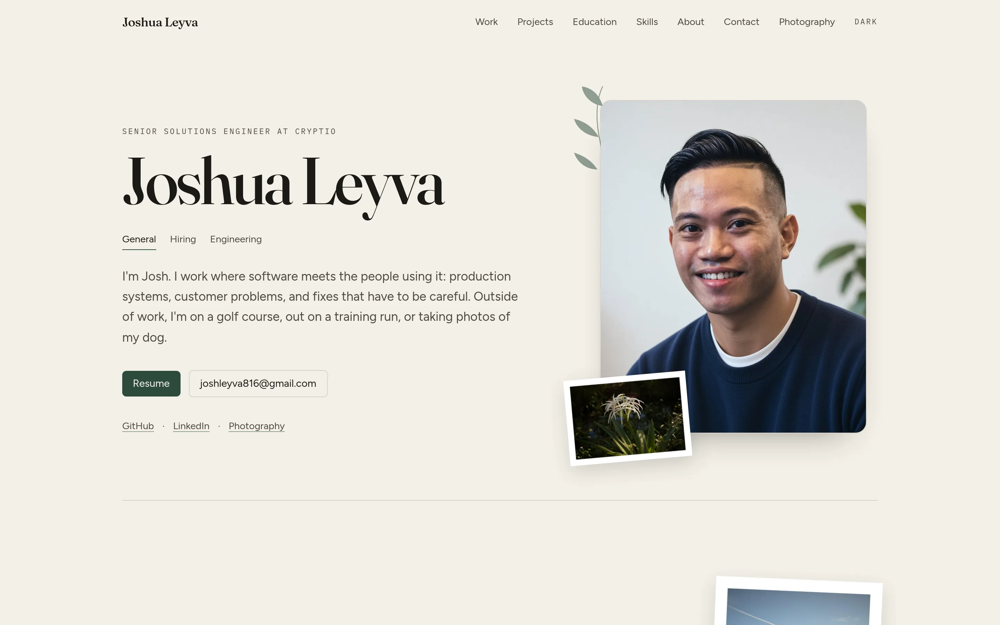
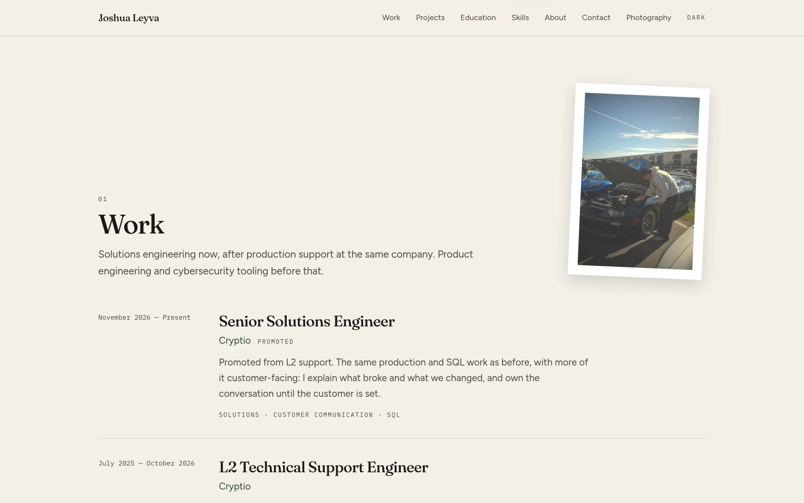
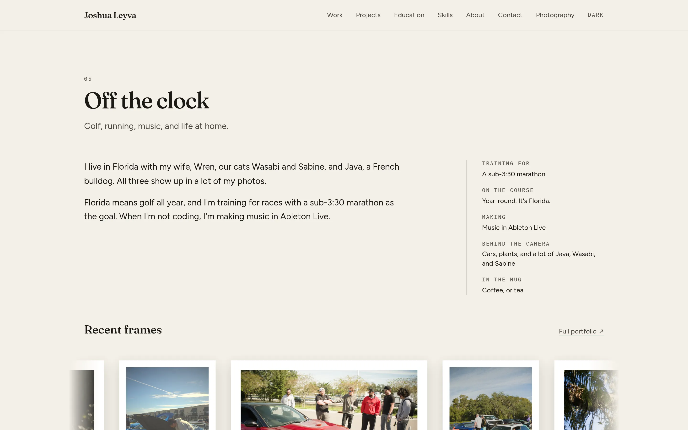
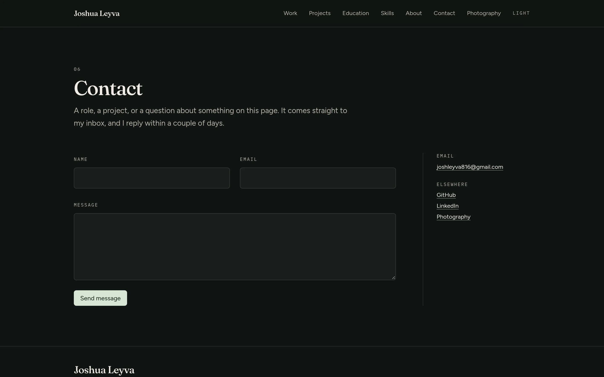
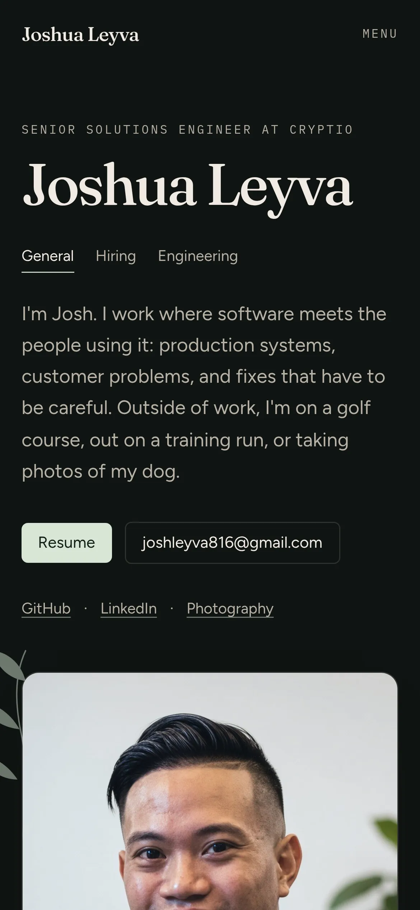

<div align="center">

# Joshua Leyva

Senior Solutions Engineer at Cryptio. This is the source for my personal site.

[**joshleyva.dev**](https://joshleyva.dev) · [Photography](https://jnleyvaphotos.vercel.app) · [LinkedIn](https://www.linkedin.com/in/joshua-leyva-0b9942b6/)


<picture>
  <source media="(prefers-color-scheme: dark)" srcset="docs/screenshots/hero-dark.webp" />
  
</picture>

</div>

## What's on the page

- **An intro for each kind of visitor.** General, Hiring, and Engineering tabs change the hero copy.
- **Work, projects, education, skills.** All of it is data-driven, so updating the resume means editing one file.
- **Photos throughout.** Framed shots sit between sections, an endless carousel shows every photo in the folder, and a lightbox opens on click.
- **Off the clock.** Golf, running, music in Ableton, and the cats and dog, plus a jazz mix that loads only when someone presses play.
- **Contact form.** Messages go straight to my inbox through a Vercel function and Resend, with rate limiting, optional Turnstile, and a mailto fallback.
- **Light and dark.** Follows the system setting by default. The header toggle reveals the new theme in a circle using View Transitions.
- **Lightbox.** Photos grow out of the thumbnail you click, and Prev/Next morphs between them.
- **Motion that respects people.** Animations are tokenised, and `prefers-reduced-motion` turns them off.
- **Design notes.** `/#studio` shows the type, border, and motion choices side by side.

<table>
  <tr>
    <td width="50%"></td>
    <td width="50%"></td>
  </tr>
  <tr>
    <td width="50%"></td>
    <td width="50%" align="center">
      
      
    </td>
  </tr>
</table>

## Stack

| Layer | Choice |
| --- | --- |
| UI | React 19, Framer Motion, and View Transitions for the lightbox and theme switch |
| Styling | Tailwind CSS v4 with CSS-variable design tokens (`@theme inline`) |
| Type | Fraunces (display), Figtree (body), IBM Plex Mono (labels), self-hosted through Fontsource |
| Build | Vite 8 (Rolldown) |
| Images | `vite-imagetools` turns each photo into AVIF, WebP, and JPEG at four widths |
| Hosting | Vercel: a static site, `api/` serverless functions, Analytics, and Speed Insights |
| Email | [Resend](https://resend.com) REST API, with no SDK |

## Running it locally

You need Node 22.12 or newer.

```bash
git clone git@github.com:jnleyva816/imjoshleyva.git
cd imjoshleyva
npm install
npm run dev        # http://localhost:5173
```

The dev server also serves `/api/contact` through a small Vite plugin, so the contact form works locally if the env vars below are set.

| Script | What it does |
| --- | --- |
| `npm run dev` | Vite dev server with the local API |
| `npm run build` | Production build into `dist/` |
| `npm run preview` | Serves the production build |
| `npm run lint` | ESLint (flat config) |
| `npm test` | Unit tests for the contact API (Node's built-in test runner) |
| `npm run test:e2e` | Playwright smoke and CSP tests against the production build, desktop and mobile |

On NixOS, point Playwright at a system Chromium with `CHROME=$(command -v chromium) npm run test:e2e`.

### Environment

Put these in `.env.local` for local work, and in Vercel under Settings → Environment Variables for Production and Preview.

| Variable | Required | Notes |
| --- | --- | --- |
| `RESEND_API_KEY` | yes | Resend API key |
| `CONTACT_TO_EMAIL` | yes | Inbox that receives messages |
| `CONTACT_FROM_EMAIL` | no | Defaults to `Portfolio <onboarding@resend.dev>`. Set it after verifying a domain in Resend. |
| `UPSTASH_REDIS_REST_URL`, `UPSTASH_REDIS_REST_TOKEN` | no | Global rate limit for the contact form. The `KV_REST_API_*` names from Vercel's Upstash integration work too. |
| `VITE_TURNSTILE_SITE_KEY` | no | Shows the Cloudflare Turnstile check on the form. It's read at build time. |
| `TURNSTILE_SECRET_KEY` | no | Makes the API require a valid Turnstile token. Set it together with the site key. |

Until a domain is verified, `onboarding@resend.dev` can only deliver to the address that owns the Resend account.

## Security

- **Headers.** `vercel.json` sets a strict Content-Security-Policy, HSTS, `nosniff`, `X-Frame-Options: DENY`, COOP, and a Permissions-Policy that only lets the YouTube embed autoplay. `e2e/csp.spec.js` fails if the page needs something the CSP blocks.
- **Contact form.** Same-origin check, honeypot, length limits, escaped HTML, and 5 messages per IP every 10 minutes. The limit is global with Upstash and per-instance without it. Turnstile verification is optional.
- **Privacy.** Fonts are self-hosted, and YouTube loads from `youtube-nocookie.com` only after someone presses play.
- **Upkeep.** Dependabot opens grouped weekly updates, and CI runs lint, unit tests, build, and Playwright on every pull request.

## Editing content

Almost everything is plain data. You shouldn't need to touch components.

| What | Where |
| --- | --- |
| Hero intros, nav, section titles and order, About, music, social links | `src/content/site.js` |
| Jobs, projects, education, skills | `src/data/*.js` |
| Photos | Drop JPEGs into `src/assets/photos/working/`. Captions and order go in `src/content/photos.js`. |
| Portrait | `src/assets/profile_picture.jpg` |

New photos join the carousel automatically. The first few in the list also fill the framed spots between sections.

## Layout

```
.github/                CI workflow and Dependabot
api/
  contact.js            Vercel function: validation, rate limit, Turnstile, Resend call
docs/screenshots/       README images
e2e/                    Playwright smoke and CSP tests
public/                 Share image, robots.txt, sitemap.xml
src/
  App.jsx               Section order and the #studio route
  index.css             Tokens, light and dark themes, marquee, View Transitions
  components/           Hero, Experience, Projects, About, Contact, PhotoCarousel, ...
  content/              Site copy and photo metadata
  data/                 Resume data
  lib/                  Motion presets, photo loading, lightbox, theme, View Transitions
tests/                  Contact API unit tests
vercel.json             Security and cache headers
vite.config.js          Image pipeline and the local /api middleware
```

## Deploying

`main` deploys to production on Vercel at [joshleyva.dev](https://joshleyva.dev), and the old `imjoshleyva.vercel.app` address redirects there. Every pull request gets a preview deployment, and previews require Vercel Authentication.

### Updating the screenshots

Start the dev server, then capture with headless Chromium through Puppeteer at 1440×900 @2x and 390×844 @3x, in light and dark. Save them as WebP in `docs/screenshots/`.

---

<div align="center">

[joshleyva816@gmail.com](mailto:joshleyva816@gmail.com) · [GitHub](https://github.com/jnleyva816) · [LinkedIn](https://www.linkedin.com/in/joshua-leyva-0b9942b6/) · [Photography](https://jnleyvaphotos.vercel.app)

</div>
