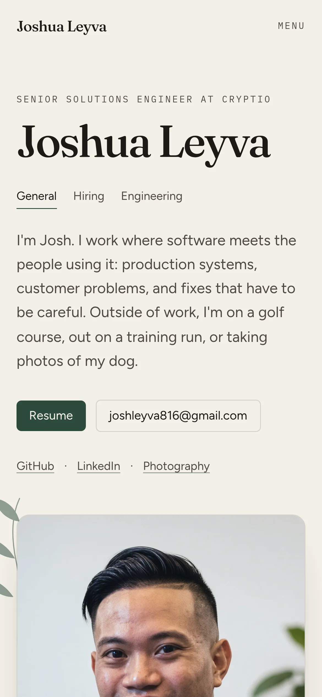

<div align="center">

# Joshua Leyva

Senior Solutions Engineer at Cryptio. This is the source for my personal site.

[**joshleyva.dev**](https://joshleyva.dev) · [Photography](https://jnleyvaphotos.vercel.app) · [LinkedIn](https://www.linkedin.com/in/joshua-leyva-0b9942b6/)


<picture>
  <source media="(prefers-color-scheme: dark)" srcset="docs/screenshots/hero-dark.webp" />
  
</picture>

</div>

## What's on the page

- **An intro for each kind of visitor.** Hiring, Engineering, and General tabs change the hero copy and the buttons under it: the résumé and LinkedIn, case studies and GitHub, or photos.
- **Work, projects, skills and education.** All of it is data-driven, so updating the resume means editing one file. A job can carry one measured result (`impact`), and a project a screenshot (`image`).
- **Case studies.** Projects with a `caseStudy` in `src/data/projectsData.js` get their own page at `/projects/<slug>`: why, what it does, how it works, decisions, and what's next.
- **Résumé page.** `/resume` is the résumé as a web page that reads well on a phone, with the PDF one click away.
- **Command menu.** Ctrl K or ⌘K (or the button in the header) jumps to sections and pages, copies the email, switches the theme, and opens links. It downloads only when first opened.
- **A little live.** The hero shows my local time and a "Now" line (`now` in `src/content/site.js`). The About section shows my latest Substack posts and Strava running totals once there's something to show.
- **Photos throughout.** Framed shots sit between sections, an endless carousel shows every photo in the folder (it drifts on its own, and you can swipe or drag it), and a lightbox opens on click.
- **Off the clock.** Golf, running, music in Ableton, and the cats and dog, plus a jazz mix that loads only when someone presses play.
- **Contact form.** Messages go straight to my inbox through a Vercel function and Resend, with rate limiting, Turnstile, inline field errors, and a copy-email fallback.
- **Light and dark.** Follows the system setting by default. The header toggle reveals the new theme in a circle using View Transitions.
- **Lightbox.** Photos grow out of the thumbnail you click, and Prev/Next morphs between them.
- **Plants behind the paper.** A monstera wallpaper (photo by Natalie Kovach on Unsplash) sits fixed behind a translucent page and slowly breathes. The veil strength is `--veil` in `src/index.css`.
- **Subtle motion, in CSS.** Sections, headings, and photos animate in with scroll-driven animations (`animation-timeline: view()`), so pre-rendered text is never hidden waiting for JavaScript. Photos unmask as they enter, the nav underline is anchor-positioned to the section you are reading and glides between links, a hairline under the header tracks reading progress, link underlines draw in, and work and project rows glow under the cursor.
- **Motion that respects people.** Animations are tokenised, and `prefers-reduced-motion` turns them off.
- **Accessible by default.** Every photo has alt text (`alts` in `src/content/photos.js`), the nav marks the section you are reading, and Lighthouse accessibility is 100.
- **Installable and printable.** A favicon that follows dark mode, an Apple touch icon and web manifest, and a print view with no controls or photos and link URLs spelled out.
- **Pre-rendered pages.** The build renders every page to HTML, so text and photos paint before any JavaScript loads and the site reads fine with JavaScript off. React then hydrates it.
- **Page-to-page motion.** Cross-document View Transitions keep the header still and morph a project's title into its case study heading. Hovering a link prefetches the next page, and case studies are prerendered outright (Speculation Rules), so most clicks open instantly.
- **Link previews.** Each page has its own title, description, preview image (`public/og/`, from `npm run og`), and schema.org data (Person, ProfilePage, SoftwareSourceCode, breadcrumbs).
- **For language models.** `/llms.txt` is the whole site as plain text, built from the same data.
- **Camera details.** The lightbox shows camera, lens, and exposure read from each photo's EXIF at build time, for photos exported with their metadata.

<table>
  <tr>
    <td width="50%"></td>
    <td width="50%"></td>
  </tr>
  <tr>
    <td width="50%"></td>
    <td width="50%" align="center">
      
      
    </td>
  </tr>
</table>

## Stack

| Layer | Choice |
| --- | --- |
| UI | React 19 (pre-rendered at build time, then hydrated), CSS scroll-driven animations, native `<dialog>` and popover with `@starting-style`, CSS anchor positioning, and View Transitions for pages, the lightbox, and the theme switch |
| Styling | Tailwind CSS v4 with OKLCH design tokens (a richer moss on P3 screens) and a fluid `clamp()` type scale |
| Type | Fraunces (display, with its SOFT and WONK axes), Figtree (body), IBM Plex Mono (labels), self-hosted through Fontsource |
| Build | Vite 8 (Rolldown) |
| Images | `vite-imagetools` turns each photo into AVIF, WebP, and JPEG at four widths |
| Hosting | Vercel: a static site, `api/` serverless functions, Analytics, and Speed Insights |
| Email | [Resend](https://resend.com) REST API, with no SDK |

## Running it locally

You need Node 22 (pinned in `package.json` so Vercel builds on the same version as CI).

```bash
git clone git@github.com:jnleyva816/imjoshleyva.git
cd imjoshleyva
npm install
npm run dev        # http://localhost:5173
```

The dev server also serves the `api/` functions through a small Vite plugin, so they work locally if the env vars below are set. In dev every page renders in the browser; `npm run build` pre-renders `/`, `/resume`, and one file per case study, and Vercel serves them at clean URLs. Unknown paths get the 404 page.

| Script | What it does |
| --- | --- |
| `npm run dev` | Vite dev server with the local API |
| `npm run build` | Checks every content file against `scripts/content-schema.mjs`, builds into `dist/`, then a server build of `src/entry-server.jsx` that `scripts/prerender.mjs` uses to write each page's HTML, `llms.txt`, and `sitemap.xml` |
| `npm run preview` | Serves the production build |
| `npm run lint` | ESLint (flat config) |
| `npm run resume` | Rebuilds `src/assets/JoshuaLeyvaResume.pdf` from the same job, education, and skills data the site uses, plus `src/content/resume.js`. Needs Chromium (`CHROME=$(command -v chromium)` on NixOS). |
| `npm run og` | Rebuilds the link-preview images in `public/og/` for the résumé and case studies. Needs Chromium like `npm run resume`. |
| `npm test` | Unit tests for the API functions and the content schema (Node's built-in test runner) |
| `npm run check:content` | Just the content check: a typo in a data file fails with its path |
| `npm run test:e2e` | Playwright smoke and CSP tests against the production build, desktop and mobile |
| `npm run test:visual` | Screenshot tests (light, dark, mobile) in the pinned Playwright Docker image, the same one CI uses. Run `npm run build` first. `npm run test:visual:update` accepts a new look; review the PNG diffs in `e2e/__screenshots__` before committing. |
| `npx @lhci/cli autorun` | Lighthouse against the production build. CI fails below 90 for performance and best practices, and below 95 for accessibility and SEO (`lighthouserc.json`). |

On NixOS, point Playwright at a system Chromium with `CHROME=$(command -v chromium) npm run test:e2e`.

### Environment

Put these in `.env.local` for local work, and in Vercel under Settings → Environment Variables for Production and Preview.

| Variable | Required | Notes |
| --- | --- | --- |
| `RESEND_API_KEY` | yes | Resend API key |
| `CONTACT_TO_EMAIL` | yes | Inbox that receives messages |
| `CONTACT_FROM_EMAIL` | no | Defaults to `Portfolio <onboarding@resend.dev>`. Set it after verifying a domain in Resend. |
| `CONTACT_AUTOREPLY` | no | `true` sends senders a short fixed "got your message" reply. Needs `CONTACT_FROM_EMAIL` on a verified domain. |
| `STRAVA_CLIENT_ID`, `STRAVA_CLIENT_SECRET`, `STRAVA_REFRESH_TOKEN` | no | Running totals in About. With Upstash set, a rotated refresh token is kept there. |
| `SUBSTACK_FEED_URL` | no | Defaults to `https://joshualeyva.substack.com/feed`. |
| `UPSTASH_REDIS_REST_URL`, `UPSTASH_REDIS_REST_TOKEN` | production | Global rate limits for the contact form and CSP reports. In production the contact form refuses to run without them (503). The `KV_REST_API_*` names from Vercel's Upstash integration work too. |
| `VITE_TURNSTILE_SITE_KEY` | production | Shows the Cloudflare Turnstile check on the form. It's read at build time. |
| `TURNSTILE_SECRET_KEY` | production | Makes the API require a valid Turnstile token. Set it together with the site key. In production, a missing secret fails every message instead of skipping the check. |

Until a domain is verified, `onboarding@resend.dev` can only deliver to the address that owns the Resend account.

## Security

- **Headers.** `vercel.json` sets a strict Content-Security-Policy, HSTS, `nosniff`, `X-Frame-Options: DENY`, COOP, and a Permissions-Policy that only lets the YouTube embed autoplay. `e2e/csp.spec.js` fails if the page needs something the CSP blocks.
- **Trusted Types and reports.** Production enforces Trusted Types; `src/lib/trustedTypes.js` lets only Vercel's and Turnstile's scripts through. Preview deployments keep it report-only and also allow `vercel.live` for the Vercel toolbar; production doesn't. Violations post to `api/csp-report.js` and show up in the Vercel logs.
- **Contact form.** Fails closed: it needs an `Origin` header matching the host (a bare `curl` gets a 403), and in production (`VERCEL_ENV=production`) it refuses to run without Turnstile or a shared Upstash rate-limit store. Also a honeypot, length limits, escaped HTML, and 5 messages per IP every 10 minutes. Locally and on previews, Turnstile and Upstash stay optional.
- **Privacy.** Fonts are self-hosted, and YouTube loads from `youtube-nocookie.com` only after someone presses play.
- **Upkeep.** Dependabot opens grouped weekly updates, and CI runs lint, unit tests, the content check, build, Playwright, screenshot tests, and a Lighthouse check on every pull request.

## Editing content

Almost everything is plain data. You shouldn't need to touch components.

| What | Where |
| --- | --- |
| Hero intros, nav, section titles and order, About, music, social links | `src/content/site.js` |
| Jobs, projects and case studies, education, skills | `src/data/*.js`. The first job is your title everywhere: hero, page titles, schema.org, résumé. |
| Project screenshots | `src/assets/projects/`, named in the project's `image: { file, alt }` |
| Page titles, descriptions, previews, schema.org | `src/lib/seo.js`, built from the data files. The HTML templates hold none of it. |
| The "Now" line and the clock's time zone | `now` and `timeZone` in `src/content/site.js` |
| Photos | Drop JPEGs into `src/assets/photos/working/`. Captions and order go in `src/content/photos.js`. |
| Portrait | `src/assets/profile_picture.jpg` |

New photos join the carousel automatically. The first few in the list also fill the framed spots between sections.

## Layout

```
.github/                CI workflow and Dependabot
api/
  contact.js            Vercel function: validation, rate limit, Turnstile, Resend call, auto-reply
  writing.js            Latest Substack posts, cached at the edge
  running.js            Strava running totals, cached at the edge
  csp-report.js         Receives CSP and Trusted Types violation reports
  _lib/guard.js         Shared rate limit, client IP, and same-origin check
docs/screenshots/       README images
e2e/                    Playwright smoke, CSP, and screenshot tests
index.html, resume.html, project.html   HTML templates; the build fills them in per page
public/                 Share images, favicon and app icons, manifest, 404 page, theme-init.js, robots.txt, speculation rules
scripts/                Pre-render, résumé PDF, preview images, EXIF plugin
src/
  App.jsx               Home: section order
  pages/                Entry points for /resume and /projects/<slug>
  entry-server.jsx      Renders a page to HTML for the pre-render step
  components/Shell.jsx  Theme, wallpaper, header, footer, and ⌘K around every page
  index.css             Tokens, light and dark themes, marquee, View Transitions
  components/           Hero, Experience, Projects, About, Contact, PhotoCarousel, ...
  content/              Site copy and photo metadata
  data/                 Resume data
  lib/                  Reduced-motion hook, photo and screenshot loading, lightbox, theme, View Transitions, SEO data
tests/                  API and content-schema unit tests
vercel.json             Security, reporting, and cache headers; clean URLs
vite.config.js          Image pipeline, EXIF, pages, the local /api middleware, and clean URLs
```

## Deploying

`main` deploys to production on Vercel at [joshleyva.dev](https://joshleyva.dev). Every pull request gets a preview deployment, and previews require Vercel Authentication.

### Updating the screenshots

Start the dev server, then capture with headless Chromium through Puppeteer at 1440×900 @2x and 390×844 @3x, in light and dark. Save them as WebP in `docs/screenshots/`.

---

<div align="center">

[joshleyva816@gmail.com](mailto:joshleyva816@gmail.com) · [GitHub](https://github.com/jnleyva816) · [LinkedIn](https://www.linkedin.com/in/joshua-leyva-0b9942b6/) · [Photography](https://jnleyvaphotos.vercel.app)

</div>
